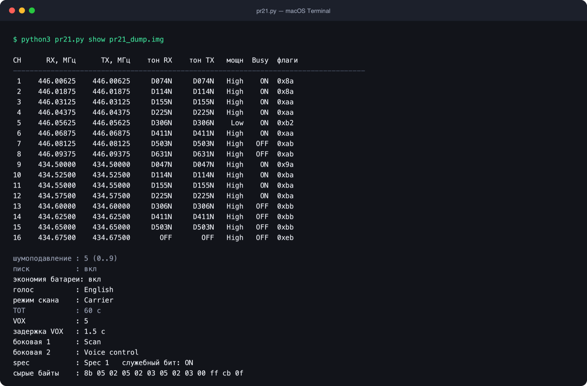
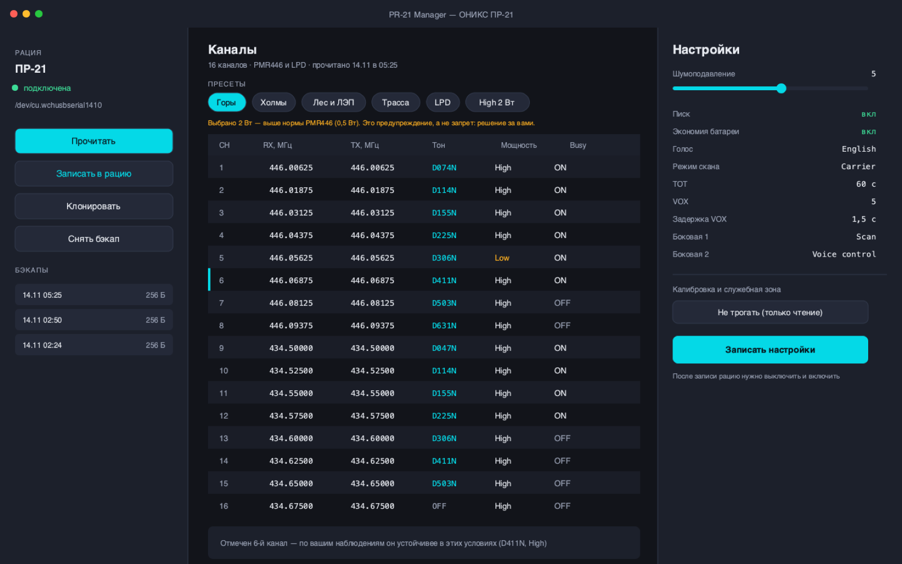

# radio-pr21-programmer

An AI-agent skill plus a working toolkit for reading and writing **ONIKS PR-21** (M31 platform)
handheld radios over a Kenwood 2-pin programming cable (CH340 USB-UART).

Runs on macOS, Windows and Linux. No vendor software, no extra drivers beyond the OS built-ins.



*Real output: all 16 channels and every radio setting read from a physical ONIKS PR-21,
then decoded offline from a saved memory image.*

## Why this exists

The vendor only ships a Windows CPS, and the radio answers to a single undocumented magic word.
The protocol here was recovered by reverse-engineering the vendor's own CPS files and verified
against real hardware — every field is confirmed by write-and-read-back, not guessed.

## What it does

- **Channels** — 16 slots: RX/TX frequency, DCS or CTCSS tone, power, busy lock, scan flag.
- **Settings** — squelch, beep, battery save, voice language, TOT, VOX level and delay,
  side key 1/2 actions, scan mode, spec mode.
- **Backup and restore** — a full 256-byte memory image, byte-compared after every write.
- **Cloning** — read one radio, write the same image into another.
- **Presets** — ready-made sets for mountains, hills, forest, road and short-range use,
  with the Russian regulatory limits documented alongside.

## Quick start

```bash
python3 -m pip install pyserial

python3 scripts/pr21.py read --out radio.img     # read the radio, save an image
python3 scripts/pr21.py show radio.img           # decode an image offline
python3 scripts/pr21.py settings                 # show squelch, VOX, TOT, side keys
python3 scripts/pr21.py settings --squelch 6     # change one setting
python3 scripts/pr21.py write radio.img --yes    # write with backup and verification
```

## Using it as an agent skill

`SKILL.md` is written for LLM agents: it states when to trigger, the safe order of operations,
the protocol, and the five mistakes that cost hours (wrong byte counts on reads, unaligned
writes, writing past the working area, testing with the cable plugged in, and the 4-byte column
offset inside the vendor CPS).

Point your agent's skill directory at this repository, or paste `SKILL.md` and the `references/`
folder into the task context.

## Planned desktop app



*This is a design mockup of the planned macOS app (SwiftUI), not a screenshot of a shipped
build. The core protocol layer is already implemented and cross-checked against the Python
reference; the GUI is still in progress. Mockup source: `docs/design-brief.md` lineage in the
project repository.*

## Repository layout

| Path | Contents |
|---|---|
| `SKILL.md` | agent instructions: triggers, workflow, protocol, pitfalls |
| `references/protocol.md` | wire protocol in full |
| `references/memory-map.md` | memory layout: channels, flags, settings |
| `references/presets.md` | terrain presets with the legal basis and sources |
| `references/compatible-models.md` | models that may work, and how to check |
| `references/troubleshooting.md` | when the radio does not answer |
| `scripts/pr21.py` | working CLI and reference implementation |
| `assets/presets.json` | presets in machine-readable form |
| `examples/pr21_dump.img` | memory image for testing without hardware |

## Safety

Writes touch only the channel area and only in 13-byte aligned blocks. The service area
(calibration) is left alone unless explicitly requested. Every write is preceded by an image
backup and followed by a read-back comparison.

## Legal note

PMR446 and LPD use in Russia is limited in power and channel grid (GKRCh decisions
No. 05-10-02-001 and No. 07-20-03-001). The tool does not block any power setting, but the
documentation warns when a value exceeds the norm. The decision stays with the operator.

## Origin

Protocol recovered from the vendor CPS (entry magic `CD18RAM`, block format, settings map) and
verified on a physical radio on 2026-11-14. No vendor binaries or decompiled sources are
included in this repository.

## License

MIT — see `LICENSE`.

---

## По-русски, коротко

Навык для ИИ-моделей и утилита: чтение и запись каналов и настроек раций **ОНИКС ПР-21**
(M31) через гарнитурный кабель Kenwood 2-pin на CH340. Работает на macOS, Windows и Linux.

Протокол восстановлен реверс-инжинирингом CPS производителя и проверен на живом устройстве:
вход по `CD18RAM`, блоки по 13 байт, карта каналов и настроек. Перед каждой записью снимается
образ, после — сверка чтением. Правовая рамка (решения ГКРЧ по PMR446 и LPD) описана в
`references/presets.md`: программа не запрещает мощность, но предупреждает о превышении нормы.
