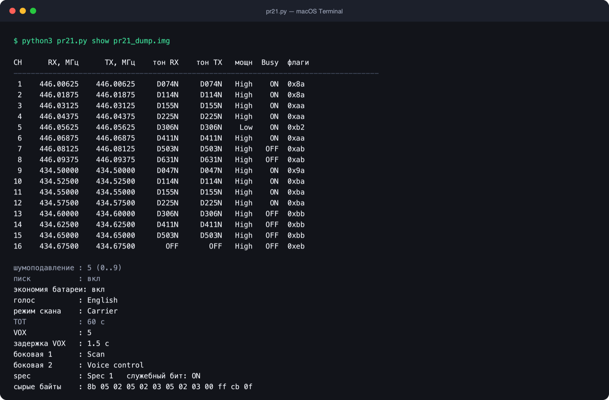
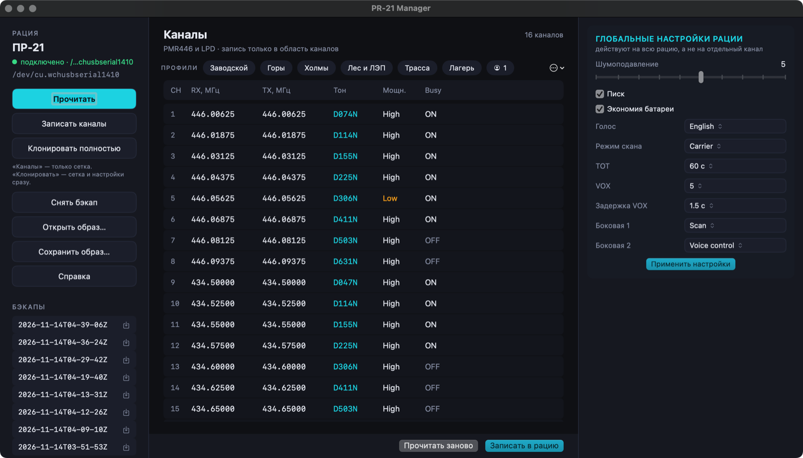

# radio-pr21-programmer

[English](README.md) · **Русский**

Навык для ИИ-моделей и рабочий набор инструментов: чтение и запись каналов и настроек
радиостанций **ОНИКС ПР-21** (платформа M31) через гарнитурный кабель Kenwood 2-pin
на USB-UART CH340.

Работает на macOS, Windows и Linux. Без фирменного софта и без драйверов сверх системных.



*Реальный вывод: все 16 каналов и все настройки, снятые с физической ОНИКС ПР-21 и разобранные
из сохранённого образа памяти.*

## Проверено на железе

| Что | Значение |
|---|---|
| Рация | **ОНИКС ПР-21**, 16 каналов, 400–480 МГц, 0,5 / 2 Вт, без дисплея, платформа M31 |
| Кабель | USB-UART **CH340** (VID 0x1a86 / PID 0x7523), Kenwood 2-pin (3,5 мм + 2,5 мм) |
| Хост | macOS 15.8.3, Intel (ранее та же рация читалась фирменным CPS на Windows) |
| Дата | 14.11.2026 |

Что именно подтверждено на этом устройстве, а не предположено:

- **Чтение** — разобраны все 16 каналов; сверка с экраном фирменного CPS: **16 из 16**, включая
  DCS-коды и выключенный тон на 16-м канале.
- **Настройки** — шумоподавление 5, писк вкл, экономия батареи вкл, голос English, скан Carrier,
  TOT 60 с, VOX 5, задержка 1,5 с, боковые кнопки Scan и Voice control — всё совпало с CPS.
- **Запись** — изменён тон канала, рация подтвердила, чтение подтвердило изменение, затем
  исходный образ возвращён и сверен побайтно.
- **Поведение шумоподавления** — уровень 0 открывал шум, уровень 5 снова давал тишину.
- **Бэкап и откат** — образ на 256 байт записан назад и совпал с источником.

Рация отдаёт 8-байтовый идентификатор, который меняется от сессии к сессии; утилита на него
не опирается.

**Другие модели не проверялись.** ОНИКС ПР-20, ПР-25, ПР-27, ПР-28 и ПР-61 выглядят похоже
по документации (тот же бренд, тот же гарнитурный разъём, тот же программатор), но ни одной
из них на руках не было. Критерии совместимости и безопасный способ проверить свою модель —
в `references/compatible-models.md`.

## Зачем это

Производитель выпускает только Windows-программу, а рация отвечает на одно недокументированное
слово. Протокол здесь восстановлен реверс-инжинирингом файлов CPS и проверен на живом
устройстве: каждое поле подтверждено записью и обратным чтением, а не догадкой.

## Что умеет

- **Каналы** — 16 слотов: частота RX/TX, тон DCS или CTCSS, мощность, busy lock, флаг скана.
- **Настройки** — шумоподавление, писк, экономия батареи, язык голоса, TOT, VOX и его задержка,
  действия боковых кнопок, режим сканирования, spec.
- **Бэкап и откат** — полный образ памяти на 256 байт, побайтовая сверка после каждой записи.
- **Клонирование** — прочитать одну рацию и залить тот же образ во вторую.
- **Пресеты** — готовые наборы под горы, холмы, лес, трассу и ближнюю связь, рядом описаны
  ограничения РФ по мощности и сетке частот.

## Быстрый старт

```bash
python3 -m pip install pyserial

python3 scripts/pr21.py read --out radio.img     # прочитать рацию, сохранить образ
python3 scripts/pr21.py show radio.img           # разобрать образ без рации
python3 scripts/pr21.py settings                 # шумодав, VOX, TOT, боковые кнопки
python3 scripts/pr21.py settings --squelch 6     # изменить одну настройку
python3 scripts/pr21.py write radio.img --yes    # записать с бэкапом и сверкой
```

## Как навык для агента

`SKILL.md` написан для ИИ-агентов: когда срабатывать, безопасный порядок действий, протокол и
пять ошибок, которые стоят часов работы (неверное число байт при чтении, невыровненная запись,
выход за рабочую область, тест с воткнутым кабелем и сдвиг на 4 в «колонках» CPS).

Подключите каталог навыков агента к этому репозиторию либо передайте `SKILL.md` и папку
`references/` в контекст задачи. Русская версия — `SKILL.ru.md`, русские справочники —
`references/ru/`.

## Приложение



*Снимок работающего приложения: прочитаны 16 каналов, сверху профили, справа глобальные
настройки рации, ниже бэкапы. Исходники — в отдельном закрытом проекте; рецепт сборки описан
в `BUILD.ru.md`. Приложение в работе и публикуется как есть — см. раздел о статусе.*

## Языковые версии

| Версия | Файлы |
|---|---|
| English | `SKILL.md`, `references/*.md`, `README.md` |
| Русский | `SKILL.ru.md`, `references/ru/*.md`, этот README |

## Статус: как есть

Это личный инструмент, опубликованный **как есть**. Он работает на железе, описанном выше,
и ни на чём другом не проверялся. Ожидания:

- **Гарантий нет, обязательств по поддержке тоже.** Что-то не работает — правьте сами: форк,
  патч или поручите агенту.
- **Issues и pull request могут остаться без ответа.** Дежурного сопровождающего нет.
- **Запись в рацию может испортить настройки.** Держите образ, который программа снимает перед
  каждой записью; в репозитории есть образ для проверки без железа.
- **Протокол восстановлен реверс-инжинирингом**, а не лицензирован у производителя. Ничего
  здесь не одобрено ОНИКС.

Если нужно, чтобы работало, — относитесь к коду как к заготовке, а не к продукту.

## Состав репозитория

| Путь | Что внутри |
|---|---|
| `SKILL.md` / `SKILL.ru.md` | инструкция для агента: триггеры, порядок работы, протокол, грабли |
| `references/*.md` | протокол, карта памяти, пресеты с правовой базой, совместимые модели, разбор сбоев |
| `references/ru/*.md` | те же справочники по-русски |
| `scripts/pr21.py` | рабочая утилита и эталонная реализация |
| `assets/presets.json` | пресеты в машинночитаемом виде |
| `assets/screenshot-app.png` | приложение, читающее реальную рацию |
| `app/` | исходники приложения для macOS (прототип на SwiftUI), см. `app/README.ru.md` |
| `BUILD.md` / `BUILD.ru.md` | как собрать и запустить |
| `examples/pr21_dump.img` | образ памяти для проверки без рации |


## Безопасность

Запись идёт только в область каналов и только блоками по 13 байт, выровненными по адресу.
Служебная зона (калибровка) не затрагивается без явного указания. Перед каждой записью
снимается образ, после записи выполняется сверка чтением.

## Правовая заметка

Использование PMR446 и LPD в России ограничено по мощности и сетке частот (решения ГКРЧ
№ 05-10-02-001 и № 07-20-03-001). Программа не блокирует мощность, но документация
предупреждает, когда значение выходит за норму. Решение остаётся за владельцем оборудования.

## Происхождение

Протокол восстановлен по файлам CPS производителя (магия входа `CD18RAM`, формат блоков,
карта настроек) и проверен на физической рации 14.11.2026. Бинарники и декомпилированные
исходники производителя в репозиторий не включены.

## Лицензия

MIT — см. `LICENSE`.

---

## English, in short

An AI-agent skill plus a working toolkit for reading and writing ONIKS PR-21 (M31) radios over a
Kenwood 2-pin cable. Runs on macOS, Windows and Linux. The protocol was recovered by
reverse-engineering the vendor CPS and verified on real hardware: `CD18RAM` entry, 13-byte
blocks, channel and settings maps. Every write is preceded by an image backup and followed by a
read-back comparison. See `README.md` for the full English version.
