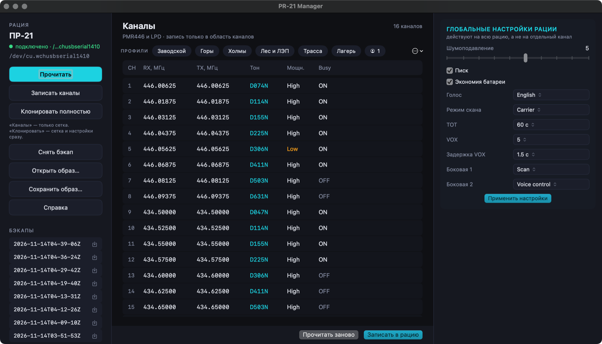

# PR-21 Manager — macOS app (prototype)

**English** · [Русский](README.ru.md)

SwiftUI application for reading and writing ONIKS PR-21 radios. This is a working prototype,
not a finished product: it reads and writes channels and settings on real hardware, but the
layout is still being reworked and some flows are unpolished.



## What works

- **Read** — 16 channels plus the settings block, with an automatic image backup on every read.
- **Edit a channel** — RX/TX frequency, DCS/CTCSS tone, power, busy lock, scan flag.
- **Profiles** — six built-in channel plans (factory, mountains, hills, forest, road, camp),
  custom profiles captured from the current radio, JSON export and import.
- **Global settings** — squelch, beep, battery save, voice, scan mode, TOT, VOX and its delay,
  both side keys.
- **Write** — channels only, or a full clone (channels + settings), with a backup first and a
  read-back comparison after.
- **Backups** — list, load into memory, export to a file.

## Build

Requirements: macOS 13+, Xcode Command Line Tools (`xcode-select --install`), Swift 5.9+.

```bash
./build.sh                 # Intel
ARCH=arm64 ./build.sh      # Apple Silicon
UNIVERSAL=1 ./build.sh     # both (not tested)
open "build/PR-21 Manager.app"
```

`make build`, `make run` and `make clean` wrap the same commands.

## Structure

| Path | Purpose |
|---|---|
| `src/core/SerialPort.swift` | POSIX serial port: 9600 8N1, DTR/RTS, poll-based reads |
| `src/core/PR21.swift` | protocol: `CD18RAM` entry, 13-byte block reads and writes |
| `src/core/Memory.swift` | channel and settings models, tone encoding, image decoding |
| `src/ui/AppModel.swift` | state, background I/O, backups, profiles |
| `src/ui/` | SwiftUI views: table, editor, settings, profiles, help |

## Known limitations

- **Intel build only has been tested.** The Apple Silicon and universal targets compile but
  have not been run.
- **The service area of the radio is never written** — only the channel area and the settings
  block. That is deliberate.
- **The narrow-bandwidth flag is unknown**, so the app does not change it.
- **The UI is a prototype.** Layout changes are in progress; expect rough edges.
- **No localisation** beyond Russian strings yet.

## Status: as is

Published as is, with no warranty and no support obligations — see the main
[README](../README.md). If you need something fixed, fork it and patch it, or hand it to an agent.

## License

MIT — see [LICENSE](../LICENSE).
