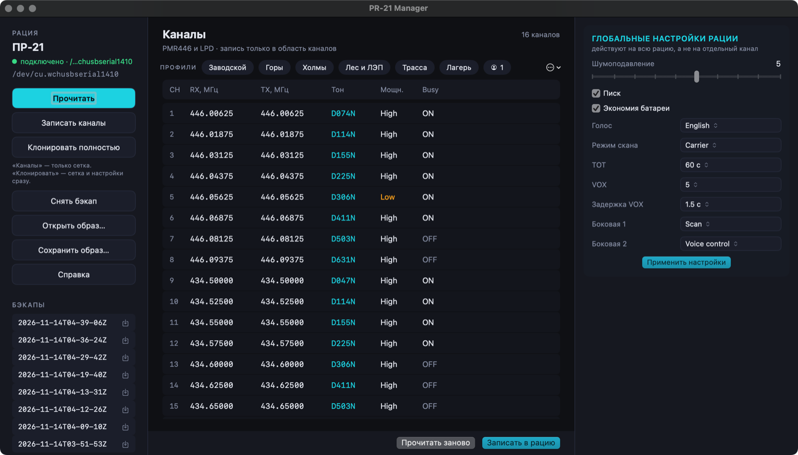

# PR-21 Manager — приложение для macOS (прототип)

[English](README.md) · **Русский**

Приложение на SwiftUI для чтения и записи раций ОНИКС ПР-21. Это рабочий прототип, а не готовый
продукт: каналы и настройки на реальном железе читаются и пишутся, но вёрстка ещё переделывается,
а часть сценариев не отполирована.



## Что работает

- **Чтение** — 16 каналов и блок настроек, с автоматическим бэкапом образа при каждом чтении.
- **Правка канала** — частота RX/TX, тон DCS/CTCSS, мощность, busy lock, флаг скана.
- **Профили** — шесть встроенных наборов (заводской, горы, холмы, лес, трасса, лагерь), свои
  профили, снятые с текущей рации, экспорт и импорт JSON.
- **Глобальные настройки** — шумодав, писк, экономия батареи, голос, режим скана, TOT, VOX и
  его задержка, обе боковые кнопки.
- **Запись** — только каналы либо полный клон (каналы и настройки), с бэкапом до и сверкой
  чтением после.
- **Бэкапы** — список, загрузка в память, сохранение в файл.

## Сборка

Нужно: macOS 13+, Xcode Command Line Tools (`xcode-select --install`), Swift 5.9+.

```bash
./build.sh                 # Intel
ARCH=arm64 ./build.sh      # Apple Silicon
UNIVERSAL=1 ./build.sh     # обе архитектуры (не проверялось)
open "build/PR-21 Manager.app"
```

`make build`, `make run` и `make clean` — те же команды.

## Структура

| Путь | Назначение |
|---|---|
| `src/core/SerialPort.swift` | последовательный порт: 9600 8N1, DTR/RTS, чтение по опросу |
| `src/core/PR21.swift` | протокол: вход по `CD18RAM`, блоки по 13 байт |
| `src/core/Memory.swift` | модели каналов и настроек, кодирование тонов |
| `src/ui/AppModel.swift` | состояние, фоновый ввод-вывод, бэкапы, профили |
| `src/ui/` | интерфейс: таблица, редактор, настройки, профили, справка |

## Известные ограничения

- **Проверена только сборка под Intel.** Цели под Apple Silicon и universal компилируются, но
  не запускались.
- **Служебная зона рации не пишется никогда** — только каналы и блок настроек. Это осознанно.
- **Бит узкой полосы неизвестен**, приложение его не меняет.
- **Интерфейс — прототип.** Вёрстка переделывается, шероховатости возможны.
- **Локализации нет**: строки только на русском.

## Статус: как есть

Публикуется как есть, без гарантий и обязательств по поддержке — см. главный
[README](../README.ru.md). Нужно починить — форк и патч, либо поручить агенту.

## Лицензия

MIT — см. [LICENSE](../LICENSE).
